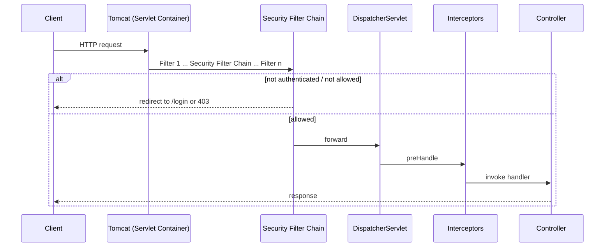
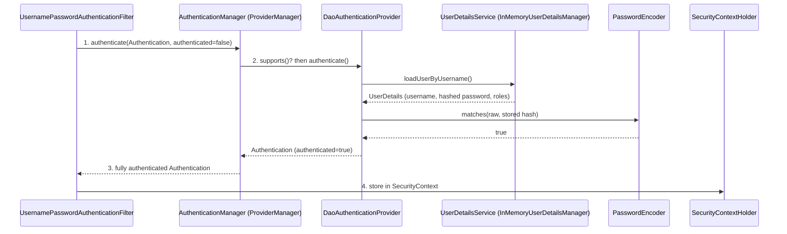
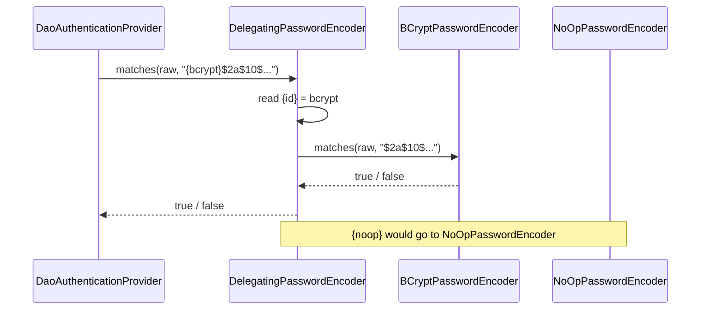
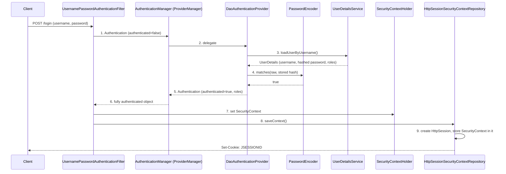
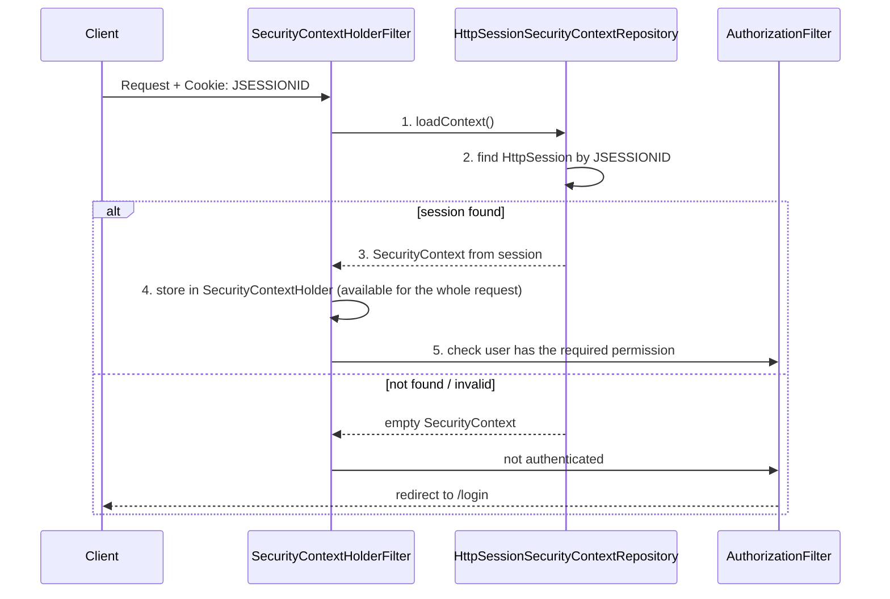

# Form Based Authentication — Spring Security

## 1. Architecture

### 1.1 Why Spring Security

| Term | Question it answers |
|---|---|
| **Authentication** | Who are you? |
| **Authorization** | What are you allowed to do? |

### 1.2 Where it sits in the request path

Spring Security is a **filter** inside the servlet filter chain — it runs before the `DispatcherServlet`, so a request is checked before it reaches any controller.



### 1.3 Components



| Component | Type | Role |
|---|---|---|
| `UsernamePasswordAuthenticationFilter` | class | Reads username/password from the login form and builds an `Authentication` object |
| `AuthenticationManager` | interface | Entry point for authentication. Default impl: `ProviderManager` |
| `ProviderManager` | class | Holds a list of `AuthenticationProvider`s and asks each one `supports(...)`; the first that supports it does the `authenticate(...)` |
| `DaoAuthenticationProvider` | class | Authenticates username/password using `UserDetailsService` + `PasswordEncoder` |
| `UserDetailsService` | interface | Loads the user (`loadUserByUsername`). Here: `InMemoryUserDetailsManager` |
| `PasswordEncoder` | interface | Matches the incoming raw password against the stored hash |
| `SecurityContext` | interface | Holds the authenticated `Authentication` for the current request (via `SecurityContextHolder`) |

### 1.4 Java / Spring mapping

| Spring Security | Plain Java / Spring analogy |
|---|---|
| Security Filter Chain | A `jakarta.servlet.Filter` that runs before the controller |
| `AuthenticationManager` → `ProviderManager` | Strategy pattern: loop over a `List<Provider>`, pick the one whose `supports()` is true |
| `UserDetailsService` | A repository/DAO: `findByUsername(...)` |
| `SecurityContextHolder` | A `ThreadLocal<SecurityContext>` — the logged-in user for the current request thread |

```java
// What ProviderManager does, simplified
for (AuthenticationProvider p : providers) {
    if (!p.supports(auth.getClass())) continue;
    Authentication result = p.authenticate(auth);
    if (result != null) return result;
}
throw new ProviderNotFoundException(...);
```

---

## 2. User Creation

Authentication can happen only after a user exists.

### 2.1 Default user (no config)

Just adding `spring-boot-starter-security` and starting the app:

```
Using generated security password: <random-uuid>
```

- Username: `user`
- Password: random UUID, **new on every restart**

| Step | Class |
|---|---|
| Default values (`name = "user"`, `password = UUID.randomUUID()`, `roles = []`) | `SecurityProperties.User` |
| Builds the `InMemoryUserDetailsManager` bean from those values | `UserDetailsServiceAutoConfiguration` |
| Stores users in `Map<String, MutableUserDetails>`, key = lower-case username | `InMemoryUserDetailsManager` |

> The default user is **not** created if you define your own `UserDetailsService`, `AuthenticationProvider` or `AuthenticationManager` bean.

### 2.2 User from `application.yaml` (dev/test only)

```yaml
spring:
  security:
    user:
      name: my_username
      password: my_password
      roles: ADMIN
```

Boot binds these to `SecurityProperties.User` (setters), overriding the defaults. No generated password is printed.

### 2.3 Custom `InMemoryUserDetailsManager` bean (dev/test only)

Hierarchy: `UserDetailsService` ← `UserDetailsManager` ← `InMemoryUserDetailsManager`

```java
@Configuration
@EnableWebSecurity
public class SecurityConfig {

    @Bean
    public UserDetailsService userDetailsService() {
        UserDetails user1 = User.withUsername("my_username_1")
                .password("{noop}my_password_1")
                .roles("ADMIN")
                .build();

        UserDetails user2 = User.withUsername("my_username_2")
                .password("{noop}1234")
                .roles("USER")
                .build();

        return new InMemoryUserDetailsManager(user1, user2);
    }
}
```

---

## 3. Password Storage

### 3.1 Format: `{id}encodedPassword`

| `{id}` | Meaning |
|---|---|
| `{noop}` | Plain text, no hashing |
| `{bcrypt}` | BCrypt hash |
| `{sha256}`, `{pbkdf2}`, `{scrypt}`, `{argon2}` | Other algorithms |

### 3.2 How the password is checked at login

1. Fetch the stored password (from memory).
2. Read the `{id}` prefix.
3. `{noop}` → compare the remaining stored value directly with the provided password.
4. `{bcrypt}` → `BCryptPasswordEncoder.matches(provided, storedHash)`.



- **`DelegatingPasswordEncoder`** is the default. It delegates to the right encoder based on `{id}`, and encodes new passwords with **bcrypt** by default.
- BCrypt uses a **random salt** — encoding the same password twice gives different hashes. `matches()` uses the salt stored inside the hash.

### 3.3 Storing a BCrypt hash

```java
UserDetails user1 = User.withUsername("my_username_1")
        .password("{bcrypt}" + new BCryptPasswordEncoder().encode("my_password_1"))
        .roles("ADMIN")
        .build();
```

Login with `my_password_1` still works — `DelegatingPasswordEncoder` sees `{bcrypt}` and hands the raw password to `BCryptPasswordEncoder`.

### 3.4 Fixed `PasswordEncoder` bean → no `{id}` needed

```java
@Bean
public PasswordEncoder passwordEncoder() {
    return new BCryptPasswordEncoder();
}

@Bean
public UserDetailsService userDetailsService() {
    UserDetails user1 = User.withUsername("my_username_1")
            .password(new BCryptPasswordEncoder().encode("my_password_1"))
            .roles("ADMIN")
            .build();
    return new InMemoryUserDetailsManager(user1);
}
```

With one fixed encoder, `DelegatingPasswordEncoder` is not used, so the `{id}` prefix is not needed.

---

## 4. Form Login

### 4.1 What it is

- **Stateful** authentication — the server keeps the login state (HTTP session), so the user does not send username/password on every request.
- User enters username/password in an HTML login form.
- On success, a session (`JSESSIONID`) is created. Next requests send only the `JSESSIONID` cookie; the server validates it against the stored session.
- Default login URL: `/login`, default logout URL: `/logout`.

### 4.2 Login flow (first time — session does not exist yet)



**After successful login:**
- Logged in via `/login` directly → redirected to the default endpoint `/`.
- Tried a specific endpoint first (e.g. `/users`) → redirected to `/login`, then back to `/users`.

### 4.3 Subsequent requests (session exists)



### 4.4 Default configuration — no code needed

Form login is enabled by Boot's default `SecurityFilterChain` (`SpringBootWebSecurityConfiguration`):

```java
@Bean
@Order(SecurityProperties.BASIC_AUTH_ORDER)
SecurityFilterChain defaultSecurityFilterChain(HttpSecurity http) throws Exception {
    http.authorizeHttpRequests((requests) -> requests.anyRequest().authenticated());
    http.formLogin(withDefaults());
    http.httpBasic(withDefaults());
    return http.build();
}
```

- Every endpoint requires authentication.
- Both form login and HTTP Basic are on — a browser gets the login form, a client like curl/Postman gets Basic (decided by the `Accept` header).

---

## 5. Customising the SecurityFilterChain

To change the login/logout page or relax authentication on some endpoints, define your own `SecurityFilterChain` bean — it replaces the default one.

```java
@Configuration
@EnableWebSecurity
public class SecurityConfig {

    @Bean
    public SecurityFilterChain securityFilterChain(HttpSecurity http) throws Exception {
        http
            .authorizeHttpRequests(auth -> auth
                .requestMatchers("/users").permitAll()
                .anyRequest().authenticated()
            )
            .formLogin(Customizer.withDefaults());
        return http.build();
    }
}
```

`/users` is now open without login; everything else still needs login.

---

## 6. Authorization

- `AuthorizationFilter` compares the role required by the endpoint with the roles in the `SecurityContext`.
- By default there is **no role restriction** on any resource — you add it.

```java
.authorizeHttpRequests(auth -> auth
    .requestMatchers("/users").hasRole("USER")                 // single role
    .requestMatchers("/admin").hasAnyRole("USER", "ADMIN")     // any of these roles
    .anyRequest().authenticated()
)
```

- `hasRole("USER")` checks for `ROLE_USER` — the `ROLE_` prefix is added automatically.
- Role missing → **403 Forbidden**.
- A user can have more than one role (`roles: USER,ADMIN`).

---

## 7. Session Management

### 7.1 Session timeout

- Default HTTP session time-to-live: **30 minutes** (depends on the servlet container). Configurable:

```yaml
server:
  servlet:
    session:
      timeout: 1m
```

- The session expires after 1 minute of **inactivity**. Each request resets the timer.

### 7.2 Max sessions per user

One user can log in from many browsers. To limit it:

```java
.sessionManagement(session -> session
    .maximumSessions(1)
    .maxSessionsPreventsLogin(true)
)
```

Logging in from a second browser with the same user shows: `Maximum sessions of 1 for this principal exceeded`.

### 7.3 Session creation policies

```java
.sessionManagement(session -> session
    .sessionCreationPolicy(SessionCreationPolicy.IF_REQUIRED)
)
```

| Policy | Behaviour |
|---|---|
| `IF_REQUIRED` (default) | Session created only when needed. A public API (no auth) does not get a session |
| `ALWAYS` | Session always created (reused if present) — even for public APIs |
| `NEVER` | Never creates a session, but uses one if present |
| `STATELESS` | No session created — for stateless apps |

---

## 8. Disadvantages

1. Session management is an overhead; in distributed systems it causes **scalability** issues.
2. **Database load**: with multiple servers the session must be stored in a DB or cache — extra memory and lookup time → latency.
